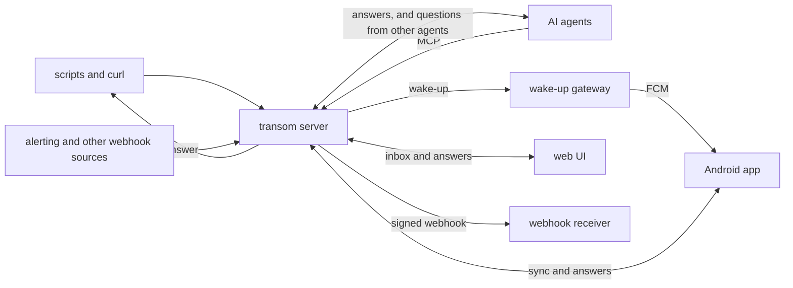

# transom design

transom lets a program ask a person a question and get the answer back,
without a chat. A question arrives on the person's phone as a
notification they can answer from the notification itself. It also
waits in an inbox, in the app and on the web, until someone answers it
or it expires. The answer goes back to the program that asked.

transom also sends one-way notifications, like alerts and status
updates, so one self-hosted server and one app cover both.

## Why

AI agents now do real work unattended: they review pull requests, keep
systems running, and work through long tasks in the background. Most of
that work needs no person. Some of it needs a person for a moment: to
approve a risky step, choose between two approaches, or answer one
question the agent cannot answer for itself.

The tools for reaching a person from an agent are chats or work
trackers. A chat assumes a session that stays open while it waits, and
someone who is watching it. An issue on a forge works, but it is heavy
for "yes or no?", and its notifications are not built for answering on
the spot. Neither fits a decision that should cost the person ten
seconds on their phone and cost the agent nothing while it waits.

The pieces exist separately, and none of them holds the whole thing:

- **ntfy** has self-hosted topics, an Android app, and action buttons,
  but no typed reply, and the notification is the only way to act on a
  message.
- **Pushover** and **Gotify** only send one way.
- **Home Assistant's** actionable notifications can carry buttons and a
  typed reply, but the notification is still the only place to answer,
  and they tie the system to a home automation server.
- **Agent approval tools** like Blipr, Pushary, and HumanLayer cover the
  agent's side, but none of them offers a self-hosted path to Android
  with typed replies.

One-way notifications have the same gap from the other side. A
self-hosted setup that sends alerts to a phone usually runs a hosted
push service and a small relay for each source that reformats webhooks
for it. A self-hosted server that each source can publish to directly
replaces both.

## Principles

- **A question is a thing with a lifecycle, not a notification.** It is
  open until it is answered, expires, or is withdrawn by the asker, and
  the first answer wins. A notification is only one view of it. That is
  what lets a dismissed notification still be answered from the inbox,
  and an answer given anywhere clear the question everywhere.
- **Answer wherever you are.** From the notification, without opening
  the app. From the app's inbox. From a browser.
- **Both ends consent.** A sender asks to reach a recipient, and a
  message flows only after the recipient accepts. Nobody gets messages
  from something they never agreed to.
- **No secrets in the service.** People and agents sign in somewhere
  else, and transom only verifies the tokens they bring. It holds no
  passwords, no API keys, and no secret shared with anyone. Its one
  secret is the private key it signs webhooks with, which never leaves
  it.
- **The asker does not have to wait.** A program can wait for the
  answer, which suits a shell script. An agent should be able to ask,
  stop, and be woken when the answer arrives, so nothing runs for hours
  while a person sleeps. transom delivers the answer to a webhook for
  that.
- **Anything that can make an HTTP request can use it.** curl is the
  first client. Agents get an MCP server on top of the same interface.
- **Self-hosted, with one exception that sees no content.** See the
  wake-up gateway below.
- **Built for this use case first.** transom's interface is designed for
  questions and answers, not copied from another service. Compatibility
  with other services' interfaces can come later, where it helps people
  move to transom.

## Architecture

### Identities and addressing

transom has two kinds of identity: individuals and groups. An
individual is a person or an agent, and transom does not tell them
apart: both send, ask, answer, and consent the same way. Individuals and
groups share one namespace, and each has a URL on the server:
`/@chris`, `/@review-bot`, `/@household`. A sender does not need to know
which kind a name is, so an individual's name can later become a group
without breaking anything that sends to it.

The URLs carry the protocol:

- Sending a message is a POST to the recipient's URL.
- Reading `/@{name}/exchanges`, with your own credentials, is your
  inbox, and as an event stream it is your live feed.
- Each exchange has a URL of its own, `/exchanges/{id}`. Replying is a
  POST to it, and the sender can wait for the outcome on it.

A group contains individuals. A message to a group reaches every
member, and for a question the first answer wins.

Because agents are individuals like people, agents ask other agents the
same way they ask people, and an agent answers from its inbox the way a
person answers from their phone.

### Exchanges

An exchange is one back and forth: a **message** from the sender, and a
**reply** if there is one. A one-way notification is an exchange with
only its message. A message with choices, or with a prompt for text,
is a **question**, which stays open until it is replied to. Any message
can be replied to with free text, so replying to an alert can start a
triage session. A reply is a choice, text, or both.

The person answering has to understand what they are deciding, so a
question has room to explain itself:

- A short summary, which the notification shows.
- A body in Markdown, as long as it needs to be, with the context behind
  the question: what the asker found, what it plans to do, and what
  each choice would lead to.
- For each choice, a short label that fits on a button, and an optional
  description in Markdown.

The app and the web UI show the whole question. The notification shows
the summary, and expanded, the start of the body, and it opens the whole
question when tapped. Its choices and text box are always there: the
person replying decides whether they have read enough.

### Consent

A message flows only when both ends have agreed:

- A sender asks to reach a recipient. The request is itself a transom
  question, "Allow @grocery-bot to send you messages?", answered with
  the same notification, inbox, and buttons as any other question.
- No individual owns another. An individual is the identity its token
  proves, and the individuals that accept it are the only ones it can
  reach.
- A group's members are peers, with no roles. Any member can accept a
  sender for the group, invite someone, or remove someone. Joining a
  group takes the new member's consent.
- Either end can revoke at any time, and delivery stops.

### Sign-in

An individual is bound to its token's issuer and subject, so a token
always means exactly one individual. A tool that someone signs in to
with their own account, like a coding agent on their laptop, acts as
them.

The first time a token arrives that no individual is bound to, it
becomes one. A PUT to a free name creates the individual under that
name, which is how an agent signs in. Any other request creates it
under the name from the issuer's name claim, which is how a person
first opening the app or the web UI gets their name. A PUT to a taken
name from a token that does not prove it is that individual gets
`403 Forbidden`. A PUT to a free name from a token that already has an
individual creates a group, with that individual as its first member.

transom does not handle passwords or keys. It trusts a configured list
of token issuers, verifies each token's signature against its issuer's
published keys, and maps the token to an identity. Different issuers fit
different callers:

- People sign in to the web UI and the app with OpenID Connect, against
  an identity provider such as Authentik.
- Agents get short-lived tokens from the same provider, or sign in with
  no secret at all through workload identity: a Kubernetes ServiceAccount
  token or a CI system's OIDC token, verified against that cluster's or
  system's published keys.
- MCP clients use the OAuth flow that the MCP authorization spec
  defines, with transom as the resource server.
- atproto sign-in is a later addition, so people can use the identity
  they already have. Nothing in the design may preclude it.

### The server

The server is the system of record. It holds the identities, the
grants, and the messages, and it delivers each message to its
recipients' inboxes.

When a question gets its outcome, the server returns it to whoever is
waiting on it. An identity can also set a webhook on its own
`/@{name}`, and the server POSTs to it, signed, whenever something
happens to that identity: an outcome of one of its questions, or a new
message for it. That is how an agent that stops between turns is woken.
The asker can attach its own data to a question, like the id of the
agent session that asked, and that data comes back with the outcome, so
the receiver knows where to route it. The recipient sees neither.

Webhooks are signed with HTTP Message Signatures (RFC 9421), using an
Ed25519 key that only transom holds. transom publishes the public key
at a well-known URL, and a receiver fetches it to verify. The signature
covers the body, the target URL, and the time, so a captured webhook
cannot be replayed later or sent to another receiver. RFC 9421 is an
IETF standard, so receivers can verify with existing libraries.

The server also serves the web UI and the MCP endpoint, so a person runs
one process.

### The Android app

The app's main screen is the inbox, which it keeps in sync with the
server and stores locally. Questions come first, open before answered.

A question's notification can be answered without opening the app:
Android allows up to three actions on a notification, and one of them
can be a reply box. A question with more choices than fit opens in the
app. When a question is answered somewhere else, expires, or is
withdrawn, the app removes its notification.

The app is a project of its own instead of an extension of ntfy's app,
because the question's lifecycle, the inbox, and clearing a notification
when it is answered elsewhere are the product, and they do not fit
inside ntfy's model of a message.

### Delivery to the phone

Android delivers background pushes reliably through Google's push
service, Firebase Cloud Messaging (FCM). Its battery management, and
that of most phone makers, will stop an app that holds its own
connection open. But FCM only sends to an app from the Firebase project
the app was built with, so a self-hosted server cannot send to the
official app on its own.

transom solves this with a **wake-up gateway**, run by the project for
the official app. A server asks the gateway to wake a device, and the
gateway sends an FCM message that carries no title, body, or sender, just
a signal to sync. The app wakes, fetches what changed from its own
server, and shows it. The gateway holds no state and never sees the
content of a message. Someone who builds the app with their own
Firebase project runs the same gateway with their own credentials.

For phones without Google services, the app can instead hold a
connection open to the server. That costs battery and needs a permanent
notification, but nothing leaves the person's own hardware.

### The web UI

The web UI shows the same inbox and answers the same questions, and it
is where people pair devices, manage groups,
and grant or revoke consent. Each
question has its own page, so any other channel can link to it.

### The MCP server

Agents send and ask through MCP tools on the server, and read and answer
their own inbox there. An agent can wait for an answer, or get an id back
at once and have the answer delivered to its webhook, which wakes it later.

## Decisions

- **Rust for everything except the Android app.** The server and the
  gateway are long-running network services that other people will run,
  and Rust gives small, fast, memory-safe static binaries. The Android
  app is Kotlin, the language of Android's own APIs.
- **Redis for storage.** The tests run against a real Redis. Images
  sent with a message are stored there too, with a size limit. Video,
  later, brings an optional S3-compatible object store for
  attachments. Durability depends on how Redis is run: an
  answer lost after someone gave it is the worst failure transom can
  have, so the documentation tells operators to run Redis with
  append-only persistence.
- **Images built `FROM scratch`.** Each image holds one static binary
  and nothing else, so there is nothing else in it to patch.
- **Distribution outside Google Play first.** The app ships as a signed
  APK on GitHub releases, which Obtainium can track. Google Play adds a
  closed test with 12 testers for 14 days for each new app on a personal
  account. That can wait until outside interest makes it worth doing.
  The app will be registered with Android's developer verification
  before it is enforced worldwide in 2027.
- **One repository** for everything transom builds and ships: the
  server, the gateway, the app, and the plans.
- **Quality gates on every change.** Formatting, linting, dependency
  audits, and 100% line coverage, enforced in CI, plus an end-to-end
  test that asks a question and answers it from a notification on an
  Android emulator. Dependencies update automatically, actions are
  pinned, and releases carry build provenance.

## Stages

1. **The server, end to end from a browser.** Notifications, questions,
   answers, webhooks, the web UI, and the MCP server. Done when an
   agent asks a question, a person answers it in a browser, and the
   agent gets the answer. This stage also adds RFC 9421 verification to
   [wicket](https://tangled.org/guid.foo/wicket), so a webhook can wake
   an agent through it.
2. **The Android app.** The inbox and answerable notifications, over a
   connection held open to the server. Done when the end-to-end test
   answers a question from a notification on an emulator.
3. **The wake-up gateway.** Done when a phone that has sat idle gets a
   question within seconds.
4. **Releases.** Published images and APKs, the transom.sh site, and a
   GitHub organization of its own.
5. **Integrations.** Sources like Alertmanager publish to transom
   directly, without a relay in front of them.
