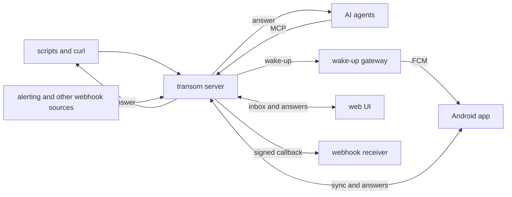

# transom design

transom lets a program ask a person a question and get the answer back,
without a chat. A question arrives on the person's phone as a
notification they can answer from the notification itself. It also
waits in an inbox, in the app and on the web, until someone answers it
or it expires. The answer goes back to the program that asked.

transom also sends one-way notifications, like alerts and status
updates, so one self-hosted server and one app cover both.

## Why

AI agents now do real work unattended: they review pull requests, keep
systems running, and work through long tasks in the background. Most of
that work needs no person. Some of it needs a person for a moment: to
approve a risky step, choose between two approaches, or answer one
question the agent cannot answer for itself.

The tools for reaching a person from an agent are chats or work
trackers. A chat assumes a session that stays open while it waits, and
someone who is watching it. An issue on a forge works, but it is heavy
for "yes or no?", and its notifications are not built for answering on
the spot. Neither fits a decision that should cost the person ten
seconds on their phone and cost the agent nothing while it waits.

The pieces exist separately, and none of them holds the whole thing:

- **ntfy** has self-hosted topics, an Android app, and action buttons,
  but no typed reply, and the notification is the only way to act on a
  message.
- **Pushover** and **Gotify** only send one way.
- **Home Assistant's** actionable notifications can carry buttons and a
  typed reply, but the notification is still the only place to answer,
  and they tie the system to a home automation server.
- **Agent approval tools** like Blipr, Pushary, and HumanLayer cover the
  agent's side, but none of them offers a self-hosted path to Android
  with typed replies.

One-way notifications have the same gap from the other side. A
self-hosted setup that sends alerts to a phone usually runs a hosted
push service and a small relay for each source that reformats webhooks
for it. A self-hosted server that each source can publish to directly
replaces both.

## Principles

- **A question is a thing with a lifecycle, not a notification.** It is
  open until it is answered, expires, or is withdrawn by the asker, and
  the first answer wins. A notification is only one view of it. That is
  what lets a dismissed notification still be answered from the inbox,
  and an answer given anywhere clear the question everywhere.
- **Answer wherever you are.** From the notification, without opening
  the app. From the app's inbox. From a browser.
- **The asker does not have to wait.** A program can wait for the
  answer, which suits a shell script. An agent should be able to ask,
  stop, and be woken when the answer arrives, so nothing runs for hours
  while a person sleeps. transom delivers the answer to a webhook for
  that.
- **Anything that can make an HTTP request can use it.** curl is the
  first client. Agents get an MCP server on top of the same interface.
- **Self-hosted, with one exception that sees no content.** See the
  wake-up gateway below.
- **Built for this use case first.** transom's interface is designed for
  questions and answers, not copied from another service. Compatibility
  with other services' interfaces can come later, where it helps people
  move to transom.

## Architecture

### The server

The server is the system of record. Publishers send it notifications
and questions on topics. A topic is a path, like `alerts/backups`, and a
subscription to a topic includes every topic under it. People subscribe
to topics, and their inbox is everything published on them.

When a question gets its outcome, the server returns it to whoever is
waiting and POSTs it, signed, to the question's callback URL if it has
one. The asker can attach its own data to a question, like the id of
the agent session that asked, and that data comes back with the answer,
so the receiver knows where to route it.

The server also serves the web UI and the MCP endpoint, so a person runs
one process.

### The Android app

The app's main screen is the inbox, which it keeps in sync with the
server and stores locally. Questions come first, open before answered.

A question's notification can be answered without opening the app:
Android allows up to three actions on a notification, and one of them
can be a reply box. A question with more choices than fit opens in the
app. When a question is answered somewhere else, expires, or is
withdrawn, the app removes its notification.

The app is a project of its own instead of an extension of ntfy's app,
because the question's lifecycle, the inbox, and clearing a notification
when it is answered elsewhere are the product, and they do not fit
inside ntfy's model of a message.

### Delivery to the phone

Android delivers background pushes reliably through Google's push
service, Firebase Cloud Messaging (FCM). Its battery management, and
that of most phone makers, will stop an app that holds its own
connection open. But FCM only sends to an app from the Firebase project
the app was built with, so a self-hosted server cannot send to the
official app on its own.

transom solves this with a **wake-up gateway**, run by the project for
the official app. A server asks the gateway to wake a device, and the
gateway sends an FCM message that carries no title, body, or topic, just
a signal to sync. The app wakes, fetches what changed from its own
server, and shows it. The gateway holds no state and never sees the
content of a message. Someone who builds the app with their own
Firebase project runs the same gateway with their own credentials.

For phones without Google services, the app can instead hold a
connection open to the server. That costs battery and needs a permanent
notification, but nothing leaves the person's own hardware.

### The web UI

The web UI shows the same inbox and answers the same questions, and it
is where people pair devices and manage the tokens publishers use. Each
question has its own page, so any other channel can link to it.

### The MCP server

Agents ask questions through MCP tools on the server. An agent can wait
for the answer, or get an id back at once and have the answer delivered
to a callback that wakes it later.

## Decisions

- **Rust for everything except the Android app.** The server and the
  gateway are long-running network services that other people will run,
  and Rust gives small, fast, memory-safe static binaries. The Android
  app is Kotlin, the language of Android's own APIs.
- **SQLite and one process.** One household or one team is the size
  transom is for. A single file is easy to run and to back up, and it
  keeps the server one container.
- **Images built `FROM scratch`.** Each image holds one static binary
  and nothing else, so there is nothing else in it to patch.
- **Distribution outside Google Play first.** The app ships as a signed
  APK on GitHub releases, which Obtainium can track. Google Play adds a
  closed test with 12 testers for 14 days for each new app on a personal
  account. That can wait until outside interest makes it worth doing.
  The app will be registered with Android's developer verification
  before it is enforced worldwide in 2027.
- **One repository** for everything transom builds and ships: the
  server, the gateway, the app, and the plans.
- **Quality gates on every change.** Formatting, linting, dependency
  audits, and 100% line coverage, enforced in CI, plus an end-to-end
  test that asks a question and answers it from a notification on an
  Android emulator. Dependencies update automatically, actions are
  pinned, and releases carry build provenance.

## Stages

1. **The server, end to end from a browser.** Notifications, questions,
   answers, callbacks, the web UI, and the MCP server. Done when an
   agent asks a question, a person answers it in a browser, and the
   agent gets the answer.
2. **The Android app.** The inbox and answerable notifications, over a
   connection held open to the server. Done when the end-to-end test
   answers a question from a notification on an emulator.
3. **The wake-up gateway.** Done when a phone that has sat idle gets a
   question within seconds.
4. **Releases.** Published images and APKs, the transom.sh site, and a
   GitHub organization of its own.
5. **Integrations.** Sources like Alertmanager publish to transom
   directly, without a relay in front of them.

## Open questions

- Should the Android app share Rust code with the server, such as the
  message types and the sync logic? It would keep the types in one
  place, at the cost of a native library in the app and a more involved
  build.
- Should people sign in to the web UI with a password only, or also
  through an identity provider they already run?
